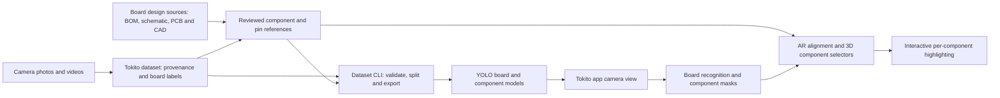
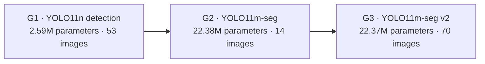

# Tokito App Dataset

**The vision-data foundation for seeing electronics as structured, interactive objects.** Tokito combines camera imagery, board-family recognition, component segmentation, and board-specific design references to support per-component understanding in the app and its AR experience.


*Board-photo examples from the ESP-12E, NXP, Ultimainboard, and Raspberry Pi collections.*

## What this dataset enables

- Recognize five embedded-board families from camera images.
- Segment visible component bodies into visual categories for per-part highlighting.
- Keep reviewed component, pin, and design-source references organized around the correct board family.
- Provide structured vision assets and validation tools for Tokito app and AR workflows.

The product idea is a live camera view where a user can select a board component and see its identity and corresponding 3D element highlighted in context. This repository provides the image, mask, source-reference, and model artifacts that support that experience.

## Hardware represented

The photo corpus covers five board families:

| Board family | Included reference material |
| --- | --- |
| ESP32 30-pin DevKit | Board photos, reviewed visual labels, and community-clone design references |
| ESP8266 NodeMCU-style ESP-12E | Board photos, module and component labels, and NodeMCU design references |
| Ultimainboard 2.1.4 | Board photos, reviewed component masks, design records, and CAD exports |
| NXP FRDM-MCXN236 | Board photos, official Rev C source package, component references, and CAD exports |
| Raspberry Pi 3 Model B v1.2 | Board photos, mechanical files, and reviewed J8 pin references |

The repository contains 80 curated board images, 466 unique reviewed component-mask instances, 240 reviewed component boxes, 62 numbered photo-contact labels, and 103 printed ESP contact aliases. The NXP source package adds 352 pin records linked to its design documentation.

## How Tokito uses the data

This diagram shows the relationship between the dataset, its command-line tools, the vision model, and the app workflow.



The workflow applies one consistent order: **board → component → pin**. It first identifies the board, then records visible component bodies, then links a pin only when its location and numbering are supported by the image and corresponding board-design references.

## Visual dataset examples

The review overlay shows component boundaries on a photographed Ultimainboard. The NXP image set shows the corresponding CAD-side view set used to organize stable component and board references.


## YOLO model generations

The dataset includes three component-vision experiments, progressing from package detection to instance segmentation. The current integration candidate is the YOLO11m-seg v2 model.

| Generation | Model | Parameters | Images | Classes | Training |
| --- | --- | ---: | ---: | ---: | --- |
| G1 | YOLO11n detection | 2.59M | 53 | 3 | 20 epochs |
| G2 | YOLO11m-seg | 22.38M | 14 | 21 | 91 epochs |
| G3 | YOLO11m-seg v2 | 22.37M | 70 | 8 | 25 epochs; best checkpoint at epoch 2 |



The selected G3 checkpoint is [`models/component-segmentation-v2/best.pt`](models/component-segmentation-v2/best.pt), SHA-256 `bde65db58f0aa724b9bb84a98e9f71c9657f2a3c07a07b7074f93424bb81eea9`. It segments eight component categories: IC packages, chip passives, connectors, RF modules, switches, crystals, discrete semiconductors, and inductors. Model reports and per-generation results are documented in the [model comparison](docs/model-comparison/component-yolo-generations-2026-10-11.md) and [model selection note](models/COMPONENT_MODEL_SELECTION.md).

## Repository layout

| Path | Contents |
| --- | --- |
| `data/photo-model/` | Board photos, crops, board labels, display names, and board-model inputs |
| `data/phone-captures/` | Hash-indexed iQOO photo and video captures |
| `annotations/` | Board, component, pin, mask, and source-link records |
| `data/board-sources/` | Schematics, board layouts, BOMs, netlists, mechanical models, and CAD exports |
| `data/external/` | External training data with provenance and attribution records |
| `models/` | YOLO checkpoints, model cards, reports, and runtime exports |
| `scripts/` | Dataset CLI, validation, training, evaluation, and export tools |
| `docs/` | Labeling guides, source inventories, model reports, and project references |
| `previews/` | Contact sheets and visual annotation reviews |

## Get started

Install Git LFS to download the larger image, CAD, and model assets:

```bash
git lfs install
git clone https://github.com/TokitoAI/tokito-app-dataset.git
cd tokito-app-dataset
git lfs pull
```

Run the dataset checks from the repository root:

```bash
python scripts/validate_dataset.py
python scripts/validate_component_yolo_annotations.py
python scripts/model_readiness.py
```

For board-family training, use a CUDA-enabled PyTorch environment and `requirements-training.txt`:

```bash
python -m venv .venv
python -m pip install -r requirements-training.txt
python scripts/train_board_detector.py
```

## Documentation

- [Board, component, and pin label hierarchy](docs/LABEL_HIERARCHY.md)
- [Board source coverage](docs/ALL_BOARD_SOURCE_COVERAGE.md)
- [AR alignment dataset and component selectors](docs/AR_ALIGNMENT_DATASET.md)
- [Repository review guide](docs/REPOSITORY_REVIEW_GUIDE.md)
- [External-data license and attribution notes](docs/sources/LICENSE_NOTES.md)

The Tokito app and AR alignment implementation are maintained separately; this repository supplies the reviewed vision data, source references, model artifacts, and dataset tooling for those workflows.
