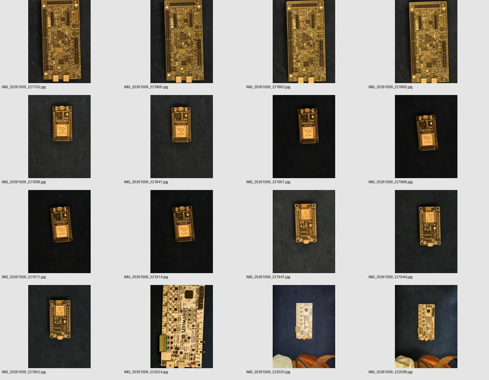
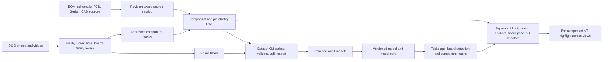

# Tokito App Dataset

**Board and component vision data for Tokito.** This repository preserves the photographed boards, reviewed labels, source-design references, dataset tooling, and YOLO experiments that feed the Tokito app. App features and 3D alignment code live in separate repositories.

> **Current status:** board-family labels and diagnostic board models are available. Component masks are still partial, and no component model has a valid full-scene, independent-specimen evaluation. Treat the current component-segmentation checkpoint as an experiment for integration tests, not as a production-accuracy model.



*Photo review examples from the ESP-12E, NXP, Ultimainboard, and Raspberry Pi collections. Repeated views may be the same physical specimen; they are not independent evaluation examples.*

## How the dataset becomes an app result

The intended flow keeps visual evidence, electrical source data, and runtime geometry linked by stable board and component identities. The dataset repository owns intake, labels, checks, and model artifacts. Its command-line tools live under `scripts/`; they validate and prepare the dataset. The app consumes the released board and component models; camera pose, 3D registration, and AR rendering are a separate app/alignment workstream.



**Label order:** identify the board family first, review each visible component body second, then assign a physical pin only when its number and position can be established from the image and a matching, oriented source. A readable marking or linked BOM candidate is evidence for review; it is not automatically proof of the installed part number.

## Dataset at a glance

| Area | Current recorded coverage | Limits to keep in view |
| --- | --- | --- |
| Board photos | 80 reviewed originals/crops across five board families; 62 train, 11 validation originals, and 7 validation crops excluded from splitting | One photographed specimen per family; no independent specimen test; ESP32 is absent from board-model validation |
| Board families | ESP32 30-pin DevKit (variant unknown), ESP8266 NodeMCU-style ESP-12E clone (variant unknown), Ultimainboard 2.1.4, NXP FRDM-MCXN236 (revision unverified), Raspberry Pi 3 Model B v1.2 | Clone/reference designs are not assumed to match the photographed board without registration |
| Component box seeds | 240 partial part boxes across 19 photos in the board-readiness audit | Visible unlabeled parts are unknown, not verified negatives; not sufficient for complete detector training |
| Reviewed segmentation annotations | Latest integrity check: 542 annotation records, 466 unique image/instance masks, no source/hash/coordinate errors | Overlap across source annotation files explains why record count differs from unique-mask count; overall labels remain partial and are not a full-scene evaluation set |
| Photo pin/contact labels | 62 numbered photo contacts and 103 printed ESP header aliases | NXP's 352 source pin records are design metadata, not photo-located pin labels; photo pin-model training is not ready |
| External component data | 53 PCB-Vision images and 106 source segmentation masks, with attribution and acquisition notes | The derived connected-region labels are proposals and may merge, split, or omit physical components |
| AR preparation | NXP source-CAD six-view synthetic export with stable component IDs and depth-tested masks | Synthetic views do not prove real camera alignment; no board has a verified complete physical top/underside/four-oblique capture set and flip evaluation |

These values come from different data products and review scripts. Do not add them together as if they were one homogeneous training set. Re-run the repository checks below for current machine-readable totals.

## Visual examples

The overlay below shows reviewed component-body boundaries on a real Ultimainboard photo. It is a partial annotation review, not a complete mask of everything visible in the frame.


The AR source preview is generated from CAD. It illustrates the desired stable component/board coordinate frame; it is not a photograph, a physical calibration result, or proof that every shown component is fitted on the photographed specimen.


## YOLO experiments and model choice

The chart below is a release-history view of all three component-model generations. The plotted scores come from different label sources and evaluation scopes, so the lines are **not a controlled improvement curve**. Every generation is marked evaluation-invalid for full-scene Tokito accuracy.


| Generation | Model / task | Parameters | Training snapshot | Reported diagnostic precision / recall | Interpretation |
| --- | --- | ---: | --- | ---: | --- |
| G1 | YOLO11n, box detection | 2.59M | 53 PCB-Vision images; 3 broad classes; 20 epochs | 0.283 / 0.140 | Held-out external connected-region box proposals; not manually reviewed instance truth |
| G2 | YOLO11m-seg, instance masks | 22.38M | 14 Tokito images; 21 observable package classes; stopped at epoch 91 | 0.429 / 0.068 | Four same-specimen partial validation frames; low recall |
| G3 | YOLO11m-seg v2, instance masks | 22.37M | 70-image training snapshot; 8 generic package classes; 25 epochs, best epoch 2 | 0.750 / 0.300 external; 1.000 / 0.136 Tokito partial scope | Best available candidate artifact, but partial proposal labels and partial local masks make both scores diagnostic only |

**Current component-model candidate:** [`models/component-segmentation-v2/best.pt`](models/component-segmentation-v2/best.pt), SHA-256 `bde65db58f0aa724b9bb84a98e9f71c9657f2a3c07a07b7074f93424bb81eea9`. Its eight outputs are generic package classes (`ic_package`, `chip_passive`, `connector`, `rf_module`, `switch`, `crystal`, `discrete_semiconductor`, and `inductor`). It does not produce exact manufacturer/SKU, board-specific reference designators, electrical pin identities, or 3D coordinates.

The G3 training report predates the later ESP-12E, NXP oblique, and ESP32 gallery-mask PRs. Those newer reviewed annotations improve the source dataset, but **they have not been included in that checkpoint's training run**. See the [full three-generation audit](docs/model-comparison/component-yolo-generations-2026-10-11.md), [machine-readable summary](docs/model-comparison/component-yolo-generations-2026-10-11.csv), [full metric table](docs/model-comparison/component-yolo-full-metrics-2026-10-11.csv), and [model selection note](models/COMPONENT_MODEL_SELECTION.md).

## Repository map

| Path | Contents |
| --- | --- |
| `data/photo-model/` | Board-family originals, crops, board boxes, split manifests, display names, and model inputs |
| `data/phone-captures/` | Hash-indexed iQOO stills and video intake, including gallery review records |
| `annotations/` | Reviewed board/component/pin annotations, masks, source links, and view audits |
| `data/board-sources/` | Collected native schematics, layouts, BOMs, netlists, mechanical files, and documented CAD exports |
| `data/external/` | External datasets and their attribution, license, provenance, and derived-label manifests |
| `models/` | Versioned checkpoints, model cards, reports, and runtime experiments |
| `scripts/` | Intake, validation, label construction, training, evaluation, export, and review utilities |
| `docs/` | Label policy, source coverage, audit reports, model comparisons, and readiness notes |
| `previews/` | Human-readable review overlays and contact sheets; canonical labels remain in `annotations/` |

## Start here

Clone with Git LFS installed so large photos, CAD, and model artifacts can be retrieved:

```bash
git lfs install
git clone https://github.com/TokitoAI/tokito-app-dataset.git
cd tokito-app-dataset
git lfs pull
```

Validate the repository and reviewed component masks:

```bash
python scripts/validate_dataset.py
python scripts/validate_component_yolo_annotations.py
python scripts/model_readiness.py
```

Train the board-family diagnostic model in an environment with CUDA-enabled PyTorch and the packages in `requirements-training.txt`:

```bash
python -m venv .venv
# Activate .venv for your shell, then install the training requirements.
python -m pip install -r requirements-training.txt
python scripts/train_board_detector.py
```

The board detector's task is board-family localization/classification. Component masks and electrical pin/source lookup are downstream tasks with separate data and readiness gates. The component segmentation source set is still incomplete; do not run a standard training export that treats unreviewed visible parts as background.

## Labels, source identity, and licenses

- Apply the same **board → component → pin** hierarchy to each board family. Unknown or unreadable identity stays unknown.
- Board-model class names and identity limits are in [`data/photo-model/board-class-display-names.json`](data/photo-model/board-class-display-names.json).
- Exact reference designator, part number, BOM, schematic, Gerber, and net links require a matching board revision and reviewed image-to-board registration. Source-only records are not photo labels.
- Keep Raspberry Pi 3B v1.2 work separate from the current active component-model priority if scheduling requires it; its source material remains preserved.
- Read [`docs/sources/LICENSE_NOTES.md`](docs/sources/LICENSE_NOTES.md) and each dataset's own attribution before redistribution. External imagery and model files retain their source terms.

Useful references: [label hierarchy](docs/LABEL_HIERARCHY.md), [all-board source coverage](docs/ALL_BOARD_SOURCE_COVERAGE.md), [AR alignment dataset contract](docs/AR_ALIGNMENT_DATASET.md), [model readiness audit](docs/MODEL_READINESS_SPRINT.md), and [repository review guide](docs/REPOSITORY_REVIEW_GUIDE.md). Changes to images, annotations, source links, and metrics should go through pull requests with provenance and validation results.

## What is not complete

1. Complete, reviewed component boundaries across the active board families, including small packages and both board faces.
2. Independent specimens and capture sessions for a valid instance-level precision/recall evaluation.
3. A retrained segmentation checkpoint that includes the latest reviewed labels and has reproducible, scope-matched metrics.
4. Photo-to-source identity and physical pin mapping only where board revision, orientation, markings, and geometry support the join.
5. Complete physical top, underside, and four oblique views plus a calibrated rotate-and-flip evaluation for each target specimen. The app/alignment implementation is a separate workstream.

A merged PR, a passing integrity check, a synthetic CAD view, or a high score on incomplete labels is not by itself evidence that the full dataset/AR objective is complete.
